# FlatMeta release report: growth + gamification (11 Nov 2026)

Branch `v2`, commits `9a5fe4d`…`9dcc782` on top of G1–G6. Every task in `tasks.md` → "Release: growth + gamification" is done (G1–G15). Each one was committed and pushed after lint, typecheck, unit/API tests and the end-to-end tests passed.

**Where it runs today:**
- **Staging, https://staging.flatmeta.io: the whole release is live.** CI deploys every green push to `v2`.
- **Production, https://www.flatmeta.io: still the previous build.** Production deploys only by hand (`scripts/deploy.sh` refuses CI). Run step 1 under "Manual steps" below.


## Mobile + SEO QA (13 Nov 2026)

A hostile mobile and SEO pass: every item in tasks.md → "Mobile + SEO QA (13 Nov 2026)" was treated as a bug. Each was reproduced on the device matrix (Playwright, Chromium and WebKit), fixed at its root, covered by a test that would have caught it, and committed separately on `v2` (MX, M1–M11, S1–S6, from `85158fa` to `d39a07a`). The per-task root causes and fixes are in tasks.md, under each ticked item.

### Where it is
- **Staging** auto-deploys each `v2` commit once its CI is green. **CI was red from the M9 push (`446ebb3`) until the CI fixes `68d88d3` and `d39a07a`.**
  - The failing step was always the Lighthouse budget; lint, typecheck, unit/API and all e2e tests passed in those runs.
  - Lighthouse ran after the e2e tests, which remove plots, so its plot page answered 404. Moved before the e2e tests, its fixed `/p/flatmeta-hq` was still not public under CI's production settings. And one Lighthouse run failed to record a trace.
  - Now the budget runs first, measures the first plot in the plot sitemap, and retries a failed Lighthouse run once.
  - **Until a run goes green, staging shows the M3 build.**
- **Production** follows staging automatically 10 minutes after a healthy staging deploy. The server steps below are manual.

### Device matrix (`apps/web/test/e2e/mobile-matrix.spec.ts`)
**Pages:** the tour, the map, walk mode, a plot page, /brands, /explore, /pricing, /business and sign-in.
**Devices:** 320×568, 360×740, 375×667, 375×812, 390×844, 412×915, 430×932, 768×1024, 1024×768, 844×390, 1280×800 and 1440×900, in Chromium and WebKit.
**Checks:**
- no sideways scroll;
- no visible control off-screen or covered (elementFromPoint);
- tap targets of at least 44 px on touch screens (24 px with a mouse);
- text of at least 12 px.

The spec's known-bugs list is **empty**: every check applies everywhere.

**After** (final run on 13 Nov, all fixes; 24 of 24 device runs passed; "pass" means it passed in both Chromium and WebKit):

| Device | home-tour | home | home-walk | plot | brands | explore | pricing | business | signin |
|---|---|---|---|---|---|---|---|---|---|
| se1-320x568 | pass | pass | pass | pass | pass | pass | pass | pass | pass |
| s8-360x740 | pass | pass | pass | pass | pass | pass | pass | pass | pass |
| se3-375x667 | pass | pass | pass | pass | pass | pass | pass | pass | pass |
| x-375x812 | pass | pass | pass | pass | pass | pass | pass | pass | pass |
| i12-390x844 | pass | pass | pass | pass | pass | pass | pass | pass | pass |
| pixel7-412x915 | pass | pass | pass | pass | pass | pass | pass | pass | pass |
| promax-430x932 | pass | pass | pass | pass | pass | pass | pass | pass | pass |
| ipad-768x1024 | pass | pass | pass | pass | pass | pass | pass | pass | pass |
| ipad-1024x768 | pass | pass | pass | pass | pass | pass | pass | pass | pass |
| phone-844x390 | pass | pass | pass | pass | pass | pass | pass | pass | pass |
| desktop-1280x800 | pass | pass | pass | pass | pass | pass | pass | pass | pass |
| desktop-1440x900 | pass | pass | pass | pass | pass | pass | pass | pass | pass |

**Before** (baseline on 13 Nov, Chromium, the build before the fixes):

| Device | home-tour | home | plot | brands | explore | pricing | business | signin |
|---|---|---|---|---|---|---|---|---|
| se1-320x568 | fail (covered, offscreen, tap, text) | fail (offscreen, tap, text) | fail (tap, text) | fail (tap, text) | fail (tap, text) | fail (tap, text) | fail (tap, text) | fail (covered, tap, text) |
| s8-360x740 | fail (covered, offscreen, tap, text) | fail (offscreen, tap, text) | fail (tap, text) | fail (tap, text) | fail (tap, text) | fail (tap, text) | fail (tap, text) | fail (tap, text) |
| se3-375x667 | fail (covered, offscreen, tap, text) | fail (offscreen, tap, text) | fail (tap, text) | fail (tap, text) | fail (tap, text) | fail (tap, text) | fail (tap, text) | fail (tap, text) |
| x-375x812 | fail (covered, offscreen, tap, text) | fail (covered, offscreen, tap, text) | fail (tap, text) | fail (tap, text) | fail (tap, text) | fail (tap, text) | fail (tap, text) | fail (tap, text) |
| i12-390x844 | fail (covered, offscreen, tap, text) | fail (offscreen, tap, text) | fail (tap, text) | fail (tap, text) | fail (tap, text) | fail (tap, text) | fail (tap, text) | fail (tap, text) |
| pixel7-412x915 | fail (covered, offscreen, tap, text) | fail (offscreen, tap, text) | fail (tap, text) | fail (tap, text) | fail (tap, text) | fail (tap, text) | fail (tap, text) | fail (tap, text) |
| promax-430x932 | fail (covered, offscreen, tap, text) | fail (offscreen, tap, text) | fail (tap, text) | fail (tap, text) | fail (tap, text) | fail (tap, text) | fail (tap, text) | fail (tap, text) |
| ipad-768x1024 | fail (covered, tap, text) | fail (covered, tap, text) | fail (tap, text) | fail (tap, text) | fail (tap, text) | fail (tap, text) | fail (tap, text) | fail (covered, tap, text) |
| ipad-1024x768 | fail (covered, tap, text) | fail (tap, text) | fail (tap, text) | fail (tap, text) | fail (tap, text) | fail (tap, text) | fail (tap, text) | fail (covered, tap, text) |
| phone-844x390 | fail (covered, offscreen, tap, text) | fail (offscreen, tap, text) | fail (tap, text) | fail (tap, text) | fail (tap, text) | fail (tap, text) | fail (tap, text) | fail (covered, tap, text) |
| desktop-1280x800 | fail (covered, tap, text) | fail (text) | fail (tap, text) | fail (tap, text) | fail (tap, text) | fail (tap, text) | fail (tap, text) | fail (covered, text) |
| desktop-1440x900 | fail (covered, text) | fail (text) | fail (tap, text) | fail (tap, text) | fail (tap, text) | fail (tap, text) | fail (tap, text) | fail (covered, text) |

### The tour, before and after (Chromium, first visit)

| Device | Before | After |
|---|---|---|
| 320×568 | 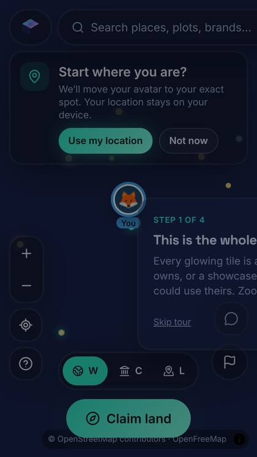 | 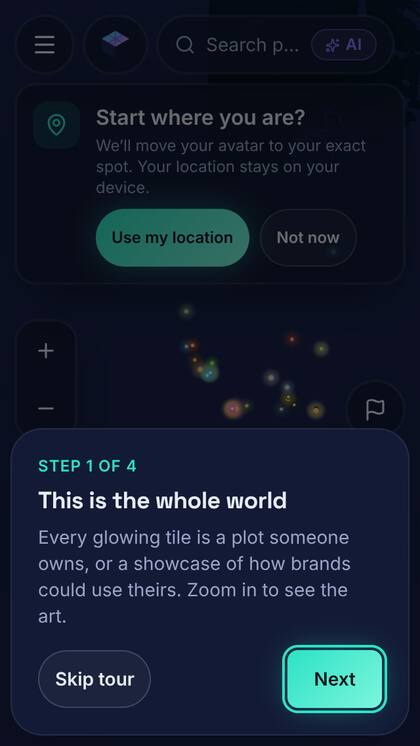 |
| 375×667 | 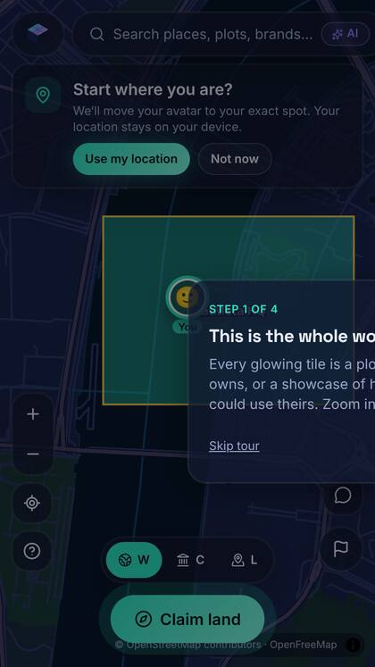 | 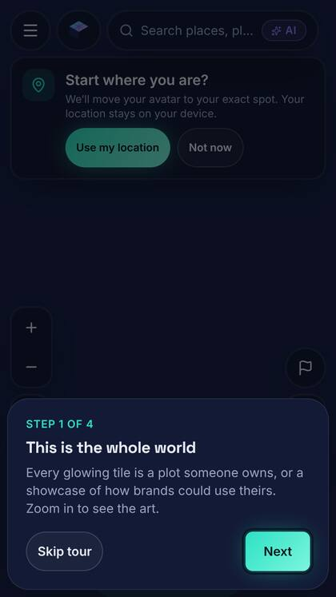 |
| 390×844 | 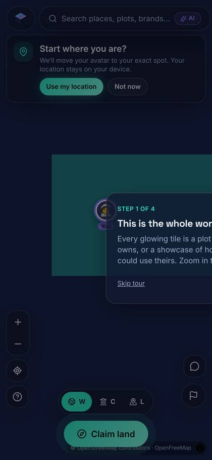 | 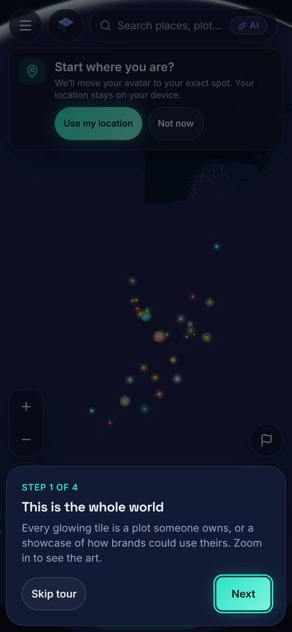 |
| 412×915 | 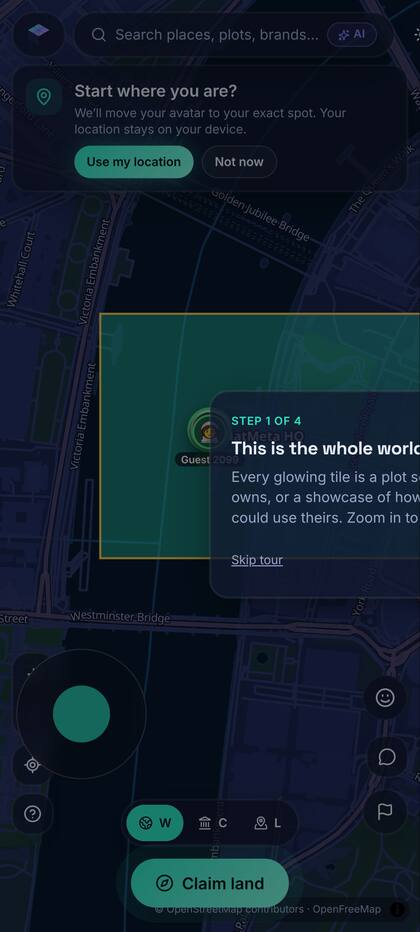 | 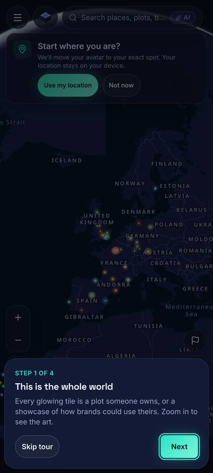 |
| 768×1024 | 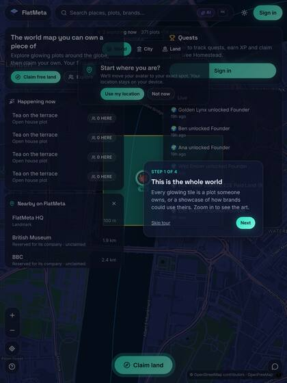 | 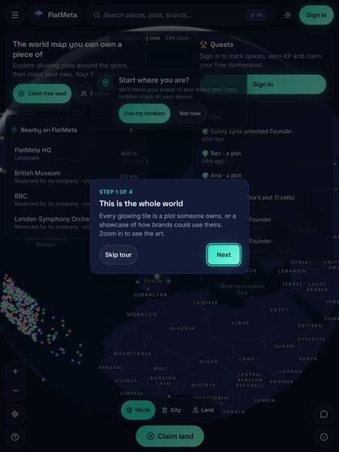 |
| 844×390 | 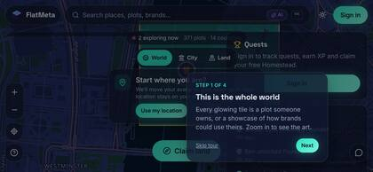 | 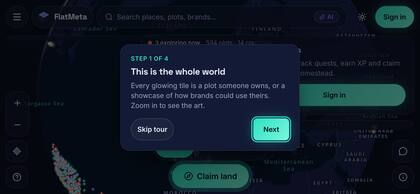 |

### Lighthouse, mobile (`scripts/lighthouse-budget.mjs`: LCP < 2.5 s, TBT < 300 ms, CLS < 0.1)

| | Score | FCP | LCP | TBT | CLS |
|---|---|---|---|---|---|
| `/` before (local; map drawn with software WebGL) | 0.36 | 1.2 s | 9.5 s | 12.3 s | 0 |
| `/` after, CI (M7 build, median of 3) | – | 1.41 s | 1.41 s | 124 ms | 0.005 |
| `/` after, CI (S4 build, median of 3) | – | 1.42 s | 1.46 s | 245 ms | 0.005 |
| plot page after (local, all fixes, median of 3) | – | 1.50 s | 1.58 s | 261 ms | 0.001 |

- **Why WebGL is off in the budget:** CI has no GPU. The budget measures all of the app's own work: HTML, hydration, data and controls. `home-start.spec.ts` checks that the idle map stops redrawing.
- **The "before" row is not like-for-like:** with software WebGL, compiling the map's shaders alone takes seconds of main thread, which no phone spends.
- **Late local numbers are noisy:** on 13 Nov this sandbox's CPU benchmark index fell from about 2,200 to 1,200–1,700, and identical code then measured 1.5–2× worse. CI, on steady hardware, is the gate.

### Sitemaps (URL counts)

| | `/sitemap.xml` | pages | plots | companies | insights |
|---|---|---|---|---|---|
| www.flatmeta.io now (old build; static file written by the insights automation) | a 60-URL list (insights and `/`) | 197 | 370 (people's plots and companies together) | – | only in the static file |
| staging (S2 build) | index of 4 sitemaps | 216 | 1 (people's plots that pass `isIndexable`) | 368 | 0 (`INSIGHTS_DIR` not set there) |
| local CI-like stack (all fixes, test data) | index of 4 sitemaps | 653 | 33 | 140 | 3 (2 fixture articles + the `/insights` hub) |

### Tests added
- **e2e, device and layout:** `mobile-matrix`, `tour`, `matrix-nav`, `matrix-brands`, `matrix-explore`, `matrix-claim`, `matrix-hints`, `home-start`, `live-socket`, `pricing`.
- **e2e, SEO and crawling:** `sitemap` (XSD-validated), `sitemap-content`, `seo` (S3), `seo-site`, `insights`, `crawl-hygiene`.
- **Unit (web):** `tour-layout`, `nearest`, `live-socket`, `plot-seo`, `seo-site`, `logo-badge`, `viewport`, `insights`, `robots`, `lib` (apex rule).
- **API:** `indexing`, `live-handshake`, `sector`, and logo trimming and fill in `company-logos`.
- **CI:**
  - xmllint for the XSD checks;
  - the Lighthouse budget;
  - the matrix screenshots and Lighthouse JSON uploaded as an artifact.

### Server steps (manual)
1. **nginx include** (as root): render, diff, install, re-apply the NodeJS template, `nginx -t && systemctl reload nginx`. The commands are in `docs/deploy-hestia.md` → "Static files in public_html", steps 1–2. The new include:
   - sends `/sitemap.xml`, `/indexnow-key.txt`, `/insights` and `/api/v1/live` (with a 3600 s read timeout) to the app;
   - returns 301 for `/insights/` → `/insights`;
   - returns 301 for every path on `flatmeta.io` → `https://www.flatmeta.io`.
2. **Move the static sitemap aside**, so it is never confused with the app's:
   ```bash
   mv /home/flatmeta/web/flatmeta.io/public_html/sitemap.xml /home/flatmeta/web/flatmeta.io/public_html/sitemap.xml.insights-old
   ```
3. **Production `.env`** (app user), then the next deploy or `pm2 reload`:
   - `INDEXNOW_KEY`: generate it on the server with `openssl rand -hex 16`. Never commit it, never paste it anywhere.
   - `INSIGHTS_DIR=/home/flatmeta/web/flatmeta.io/public_html/insights`. The app user needs read access.
   - Optionally `SAME_AS=`: FlatMeta's profile URLs, comma-separated.
4. **Once, after the deploy, in `apps/api`:**
   ```bash
   npm run company-land:logos -- --apply --refresh
   ```
   This trims and measures the logos stored before M7, so thin wordmarks show initials. Migration 0012 (one spelling per sector) runs with the deploy.
5. **Insights automation:** give it the rules in `docs/positioning.md` → "Rules for every insights article". Admin → Insights check lists the articles that break them.
6. **Check:**
   - `curl -sI https://flatmeta.io/pricing` answers 301 to www;
   - `curl -s https://www.flatmeta.io/sitemap.xml` starts with `<sitemapindex`;
   - https://www.flatmeta.io/insights lists the articles.

## Auto-deploy from cron, staging and production (12 Nov 2026)

Both checkouts on cp2 now deploy themselves, like SiteRoll. A cron job runs `scripts/auto-deploy.sh --cron` every 2 minutes as `najamussaqib`. When `v2` moves:
- **Staging** deploys the new commit once its GitHub checks pass.
- **Production** deploys the same commit once it has also been **live and healthy on staging for 10 minutes with a passing smoke test**.

Nothing deploys until `AUTO_DEPLOY=true` is in that checkout's `.env`. The full guide is `docs/deploy/auto-deploy.md`.

**What a tick does:**
1. Takes a `flock` lock. CI's staging SSH job uses the same lock, so the two never deploy at once.
2. Runs a daily database backup if the last one is older than 24 h; 7 days are kept.
3. Stops if `AUTO_DEPLOY` isn't `true`.
4. `git fetch`; stops if the tip is already live.
5. Skips a commit listed in `logs/failed-shas`; failed commits are never retried automatically.
6. Checks the commit's GitHub checks through the unauthenticated API (the repo is public):
   - pending: waits for the next tick;
   - failed: records the commit as failed.
7. Production only: needs `~/flatmeta-deploy-state/staging-ok-<sha>` (smoke passed, healthy, live for at least 10 min).
8. Runs `scripts/deploy.sh <env> --auto`:
   - `pg_dump` first (no backup, no deploy);
   - build, expand-only migrations, switch, `pm2 reload`;
   - health checks on web `/` and API `/v1/me` (200 JSON, local ports, up to 60 s);
   - HTTP smoke test.
9. **On any failure:** switches back to the previous release and reloads, records the commit in `logs/failed-shas`, and logs why, with the backup path and the `pg_restore` command. The database is not rolled back.
10. **Emails the admins** about every production deploy (commit, subject, duration) and every rollback on either environment (failing step, last 40 log lines). No secrets go into emails or logs.

**By hand** (in the checkout; production still asks you to type `production`):
- `bash scripts/auto-deploy.sh`: deploys the tip now, even a commit that failed before.
- `--sha <commit>`: deploys one commit.
- `rollback [sha]`: goes back to the previous release, or to one of the 5 kept releases.
- `status`: shows what is live, the tip, failed commits and the staging verdicts.

**Logs:**
- `logs/deploy.log`: timestamped, build output included.
- `logs/runs/`: one file per deploy.

**Also fixed: static `.txt` files in `public_html`.** Hestia serves `.txt` and `.xml` from `public_html` before the app, so a deleted `llms.txt` gave nginx's 404. `deploy/hestia/nodejs-app.conf` now proxies these to the app:
- `/llms.txt`
- `/llms-full.txt`
- `/robots.txt`
- `/sitemap-*.xml`

`/sitemap.xml` stays the insights automation's static file, which robots.txt lists. Installing the change needs root (step 6 below).

**Tests:**
- `apps/api/test/auto-deploy.test.ts` (13 tests). Each runs a real git origin in a temp dir with a fake deploy, health check, `pg_dump` and GitHub API, and covers:
  - `AUTO_DEPLOY=false`;
  - the branch not moving;
  - the lock;
  - `failed-shas` skip, and the manual override of it;
  - CI pending, failed and success;
  - our own deploy jobs ignored;
  - staging verdicts;
  - the production gate (no verdict, under 10 min, staging failed, smoke off, stale);
  - rollback.
- `apps/api/test/deploy-guard.test.ts` (7 tests).

**What changed for the earlier CI production job:** it still exists, but cron is now the production path. **Leave the `PROD_DEPLOY_*` secrets unset**, because that job doesn't wait for the 10-minute staging gate. The section below is kept for reference only.

### One-time setup on cp2

Run these as **najamussaqib**, except step 6.

1. **Get the new scripts onto both checkouts.**
   - Staging gets them with the next CI deploy of `v2`.
   - Production needs one manual deploy (you type `production`):
     ```bash
     cd /home/flatmeta/web/flatmeta.io/private/flatmeta && bash scripts/deploy.sh production
     ```
2. **Check `pg_dump`, and create the shared state folder:**
   ```bash
   pg_dump --version && mkdir -p ~/flatmeta-deploy-state && chmod 700 ~/flatmeta-deploy-state
   ```
3. **Staging `.env`** (`/home/flatmeta/web/staging.flatmeta.io/private/flatmeta/.env`), add:
   ```bash
   AUTO_DEPLOY=true
   DEPLOY_BRANCH=v2
   REQUIRE_CI=true
   HEALTH_URLS="http://127.0.0.1:3200/ http://127.0.0.1:3201/v1/me"
   ```
4. **Production `.env`** (`/home/flatmeta/web/flatmeta.io/private/flatmeta/.env`), add:
   ```bash
   AUTO_DEPLOY=true
   DEPLOY_BRANCH=v2
   REQUIRE_CI=true
   HEALTH_URLS="http://127.0.0.1:3250/ http://127.0.0.1:3251/v1/me"
   ADMIN_EMAILS=you@example.com
   ```
   `ADMIN_EMAILS` is optional; admin users in the database get the emails anyway.
5. **Cron** (`crontab -e` as najamussaqib):
   ```cron
   */2 * * * * bash /home/flatmeta/web/staging.flatmeta.io/private/flatmeta/scripts/auto-deploy.sh --cron
   */2 * * * * bash /home/flatmeta/web/flatmeta.io/private/flatmeta/scripts/auto-deploy.sh --cron
   ```
   Check:
   ```bash
   bash /home/flatmeta/web/flatmeta.io/private/flatmeta/scripts/auto-deploy.sh status
   ```
6. **nginx, as root**, so `/llms.txt`, `/robots.txt` and `/sitemap-*.xml` always reach the app:
   1. As najamussaqib, render the include file for each checkout:
      ```bash
      cd /home/flatmeta/web/flatmeta.io/private/flatmeta && node scripts/new-instance.mjs production --nginx-only
      ```
      ```bash
      cd /home/flatmeta/web/staging.flatmeta.io/private/flatmeta && node scripts/new-instance.mjs staging --nginx-only
      ```
   2. As root, confirm the include path:
      ```bash
      grep -rn "nodejs-app" /usr/local/hestia/data/templates/web/nginx/
      ```
   3. As root, compare. The diff should show only the new `location` lines at the end:
      ```bash
      diff /home/flatmeta/conf/web/flatmeta.io/nodejs/nodejs-app.conf /home/flatmeta/web/flatmeta.io/private/flatmeta/deploy/out/production/nodejs-app.conf
      ```
   4. As root, install both files:
      ```bash
      install -m 644 /home/flatmeta/web/flatmeta.io/private/flatmeta/deploy/out/production/nodejs-app.conf /home/flatmeta/conf/web/flatmeta.io/nodejs/nodejs-app.conf
      ```
      ```bash
      install -m 644 /home/flatmeta/web/staging.flatmeta.io/private/flatmeta/deploy/out/staging/nodejs-app.conf /home/flatmeta/conf/web/staging.flatmeta.io/nodejs/nodejs-app.conf
      ```
   5. As root, re-apply the template and reload nginx:
      ```bash
      v-change-web-domain-proxy-tpl flatmeta flatmeta.io NodeJS && v-change-web-domain-proxy-tpl flatmeta staging.flatmeta.io NodeJS
      ```
      ```bash
      nginx -t && systemctl reload nginx
      ```
   6. Check. Expect a 200 with `text/plain`, even with no `llms.txt` in `public_html`:
      ```bash
      curl -sI https://www.flatmeta.io/llms.txt | head -n 5
      ```
7. **If the staging CI key has a forced command** in `authorized_keys`, change it to:
   ```text
   cd … && bash scripts/deploy.sh staging --ci v2
   ```
   That form waits for a running cron deploy instead of failing.

**Pause** either environment with `AUTO_DEPLOY=false` in its `.env`; the next tick only takes the daily backup.

## Automatic production deploys by CI over SSH (12 Nov 2026, superseded by the cron section above)

Production can now deploy itself after staging passes. It stays off until you do the one-time setup below.

**How it works:**
- **CI (`.github/workflows/ci.yml`):** after the staging deploy, `smoke-staging` runs `scripts/release-smoke.cjs` against https://staging.flatmeta.io. If it passes, `deploy-production` deploys the same commit over SSH. Without the `PROD_DEPLOY_*` secrets the job is skipped with a notice.
- **Server guard (`scripts/deploy-guard.sh`, used by `deploy.sh`):** a non-interactive production deploy needs:
  - `--auto`, from a non-interactive SSH session;
  - `AUTO_DEPLOY=true` in the production `.env` (the caller can't set it);
  - a full commit SHA on `origin/v2`;
  - a commit that hasn't failed before.

  Manual deploys still ask you to type `production`.
- **Automatic deploys:**
  - `pg_dump` first (no dump, no deploy);
  - then migrations, the build and the swap;
  - health checks (API `/healthz`, web `/` and `/robots.txt`);
  - on failure: roll back to the previous release, record the commit in `.deploy/failed/` (never retried automatically), and set a failed `deploy/production` status on the commit.
- **Email:** admins get an email after every production deploy (deployed, rolled back or aborted) with the commit and the end of the log. This includes manual ones.
- **Tests:** `apps/api/test/deploy-guard.test.ts` (7 tests: the guard rules, deploy.sh refusing before it touches anything, a failed commit never retried, the SHA taken from the forced command, the email contents).

**One-time setup** (details in `docs/deploy-hestia.md` → "Automatic production deploys"):
1. Make a production-only key:
   ```bash
   ssh-keygen -t ed25519 -N '' -C flatmeta-ci-production -f flatmeta_ci_production
   ```
2. On the server, as the app user, add one line to `~/.ssh/authorized_keys`: the public key, behind a forced command:
   ```text
   command="cd /home/USER/web/flatmeta.io/private/flatmeta && bash scripts/deploy.sh production --auto",no-pty,no-port-forwarding,no-agent-forwarding,no-X11-forwarding ssh-ed25519 AAAA… flatmeta-ci-production
   ```
3. Check that `pg_dump --version` works for that user.
4. In the production `.env`, set `AUTO_DEPLOY=true`, and optionally `ADMIN_EMAILS=…` for extra recipients.
5. In GitHub secrets, set `PROD_DEPLOY_HOST`, `PROD_DEPLOY_USER`, `PROD_DEPLOY_PATH` (`/home/USER/web/flatmeta.io/private/flatmeta`) and `PROD_DEPLOY_KEY` (the private key), plus `PROD_DEPLOY_PORT` if not 22. Then delete the local key files.
6. **The first production deploy must still be by hand** (`bash scripts/deploy.sh production`). The server has to run the new `deploy.sh` once before it understands `--auto`; until then the CI job fails with "refused", and nothing changes.

## Update, 12 Nov 2026: boss feedback (H1–H3)

Three changes, each pushed to `v2` after lint, typecheck, unit/API tests (**160 passed**) and the e2e suite
(**59 passed, 0 failed**) all passed. CI runs [#37](https://github.com/MeWeBe-com/flatmeta.io/actions/runs/43179128205)
(H1) and [#38](https://github.com/MeWeBe-com/flatmeta.io/actions/runs/43180707905) (H2) are green and deployed to
staging; H3 deploys the same way.

### What's live on staging

Smoke test after the H3 deploy (`PW_CHROMIUM_PATH=… node scripts/release-smoke.cjs https://staging.flatmeta.io`): **19/19 passed**. The admin register and the logo switches answer 401 to guests. Reserved plots report `guestbookOpen: false`, and signing their guestbook is refused.

Staging already has **367 company plots** on `/brands` (140 curated plus those the daily company-land job added since G12), across 20 countries. None has a logo yet: the backfill (step H-2) hasn't been run there.

- **H1 Company logos.** Each company plot gets a small official logo, used only as a badge:
  - shown on the plot page (`/p/<slug>`) with "Logo shown to identify the company for claiming; trademarks belong to their owners." and a link to the logo's source and licence;
  - on the map from zoom 14.5, on https://staging.flatmeta.io/brands, and in the share image;
  - the generic artwork stays the main visual, and the "Reserved for …, not affiliated with FlatMeta" label stays.
  - **Staging has no logos yet:** run the backfill there (step H-2 below). The daily job only fetches logos for new plots.
- **H2 Company land register.** https://staging.flatmeta.io/admin/company-land (admins only) lists every company plot with:
  - country, HQ city, plot and map links, website, Wikidata, logo and its source, and status;
  - filters, search, CSV export, and admin-only outreach fields.
  - A daily admin digest is emailed at 06:43 UTC, and public contact pages are looked up at 05:29 UTC.
- **H3 Owner-only content.** Every way of writing plot content now follows one rule:
  - the current owner, or someone the owning organisation invited as owner, admin or editor;
  - admins can edit anything;
  - reserved, company and unclaimed land, and unpaid or released land, are admin-only;
  - the old owner loses access after a transfer.
  - Refusals return 403 with a plain reason, and only owners see edit controls.
  - Walk mode stays move, chat and emote only. The guestbook works only on owned land, and owners can close it.
  - Every content change is written to the audit log.

### H1: where logos come from, and the backfill numbers

Logos are looked up in this order, using only these two sources:
1. Wikidata P154, through the Commons API (stores the file page, licence and author).
2. The company's official website, on its own domain only: `apple-touch-icon`, then `<link rel="icon">`, then `/favicon.ico`.

Every download is checked:
- private addresses are refused inside the connection itself;
- each redirect is checked again;
- 1 MB size limit and a timeout;
- the declared content-type must match the real image bytes;
- SVGs are sanitised before rasterising;
- the result is stored as a PNG of at most 128×128.

**Dry run on the 140 curated showcase plots** (the same set as production), run from the dev database:

| Source | Plots |
| --- | --- |
| Wikidata / Commons | **65** |
| Official website | **29** |
| None found | **46** |

The 46 with none are mostly museums, orchestras, universities and venues: either the Wikidata item has no free logo, or the site only offers a BMP `.ico` or blocks bots. Examples: Manchester United, Co-op, SNCF, Louvre Abu Dhabi, Elbphilharmonie, Canva. They keep the generic artwork. There is no manual logo upload, by design: only these two sources are allowed.

Company-land plots get their logo when they are created. Production's count will grow as the daily job adds companies.

```bash
npm run company-land:logos                      # dry run: counts by source, and which have none
npm run company-land:logos -- --country GB      # one country
npm run company-land:logos -- --apply           # store them
```

### H1–H3 env vars and migrations

```bash
COMPANY_LAND_LOGOS=true       # H1: false hides every company logo (there is also an admin kill-switch in Admin -> Company land)
```

The other H1–H3 settings need no env var: the digest and contact-page jobs run by themselves.

Migrations `0009_company_logos`, `0010_company_register` and `0011_guestbook_open` are expand-only (new columns with defaults). `deploy.sh` applies them.

### Manual production steps for H1–H3

These come on top of the earlier steps below: the production deploy and the usercontent subdomain still apply.

**H-1. Deploy** (as the app user; asks you to type `production`; runs migrations 0005–0011):
```bash
cd ~/web/flatmeta.io/private/flatmeta && bash scripts/deploy.sh production
```

**H-2. Logo backfill** (production; also once on staging, in `~/web/staging.flatmeta.io/private/flatmeta`):
```bash
npm run company-land:logos              # dry run: check the counts
npm run company-land:logos -- --apply   # store them (a few minutes; Wikimedia requests are throttled)
```

**H-3. Check:**
- Admin → Company land shows the register; Download CSV works.
- A company plot page (for example `/p/bbc`) shows the small logo with the trademark line.

**H-4. Optional:** press "Find contact pages" in Admin → Company land, or wait for the daily job (60 a day).

The usercontent subdomain (steps 2–3 below) is still needed for custom HTML on production.

## What is live (staging URLs; the same paths on www.flatmeta.io after the production deploy)

| Task | What | Try it |
| --- | --- | --- |
| G1 | Growth analysis: market shifts, funnel leaks, top 10 changes | `docs/growth-analysis-2026-11.md` |
| G2 | Nonce CSP, HSTS, frame protection, Permissions-Policy | `curl -sI https://staging.flatmeta.io/` |
| G3 | Showcase bulk verify; "Nearby on FlatMeta" on first visit | https://staging.flatmeta.io/ |
| G4 | Canonical `www`, plot sitemaps, share cards, JSON-LD | https://staging.flatmeta.io/sitemap-index.xml |
| G5 | `/@handle` links, share panel, Visit deep link | https://staging.flatmeta.io/@flatmeta |
| G6 | Privacy-friendly unique visitors per plot | the plot page and the editor |
| G7 | EXIF-free uploads, gallery removal, edit and upload limits | the editor |
| G8 | Custom HTML/JS on a separate sandboxed origin:<br>• versions and restore<br>• first-publish review<br>• kill-switches<br>• reports<br>• scan for miners, credential forms and non-allowlisted hosts | editor → Content → Custom HTML; **Admin → Custom HTML** |
| G9 | Walk mode: WASD and on-screen joystick, emotes, avatar styles, swear-word masking, block-aware live map | https://staging.flatmeta.io/ (City level and closer) |
| G10 | Open houses with reminders, "people here now", "Happening now" on the map | the plot page; the editor's sidebar |
| G11 | Share prompt after a claim; invite links with bonus squares for both people; weekly owner email with one-click unsubscribe | `/dashboard` (Invite friends); `/?ref=CODE` |
| G12 | Company land from Wikidata (daily job) and reserved-plot labels:<br>• claim by work email or DNS TXT<br>• 48-hour takedowns<br>• `/brands` directory | https://staging.flatmeta.io/brands; `/claim/adnoc` |
| G13 | Upgrade dialog at every paywall (one click to Stripe, back to the same page); admin metrics | `/admin/metrics`; `docs/pricing-review.md` |
| G14 | "Ask FlatMeta" in the map search; MCP tools for agents; `llms.txt` and `llms-full.txt` | https://staging.flatmeta.io/llms.txt; `/api/mcp` |
| G15 | `/about/facts`; AI crawlers welcome in `robots.txt` (production only); WebSite + SearchAction JSON-LD | https://staging.flatmeta.io/about/facts |
| Security fix | Plot descriptions rendered as React elements, never `innerHTML` | — |

Docs added: `docs/company-land.md`, `docs/pricing-review.md`, `docs/positioning.md`, and `docs/deploy-hestia.md` → "Usercontent origin".

## Test results

| Suite | Result |
| --- | --- |
| Lint and typecheck (API and web) | clean |
| API tests: real Postgres, Redis and WebSockets | **129 passed** (was 101 before G7) |
| Web unit tests | **21 passed** (CSP, canonical URL, Markdown renderer, robots) |
| End-to-end, Playwright, desktop and mobile, against a CI-identical stack | **56 passed, 0 failed** (14 device-specific skips) |
| GitHub Actions on `v2` | runs [#32](https://github.com/MeWeBe-com/flatmeta.io/actions/runs/43052408071), [#33](https://github.com/MeWeBe-com/flatmeta.io/actions/runs/43054415110) and [#34](https://github.com/MeWeBe-com/flatmeta.io/actions/runs/43056994189) **green**, each including e2e and the staging deploy; #34 is the release head (G14/G15) |

**CI note.** Runs for G7–G11 were cancelled by the next push, not failed. They sat in `playwright install --with-deps` because the runner's apt mirror was unreachable (DNS). Lint, typecheck, the API tests and the builds had all passed in those runs. CI now installs Chromium from Playwright's CDN and calls apt only if Chromium can't start, so a run takes about 9 minutes again.

New end-to-end tests cover each task. Highlights:
- **The sandboxed custom HTML can't read cookies or localStorage, can't reach the parent page, and can't navigate it.** The probe hides its intent from the scanner, so the browser's isolation is what's being tested.
- **Two signed-in players:** emotes and WASD walking seen live by the other player.
- **Phone:** the joystick walks the avatar.
- **Invite link:** sign-up, claim, both get bonus squares.
- **Paywall → Plus checkout → back on the same page, upgraded.**
- **Brands:** the directory, the label, and the DNS claim.
- **Ask FlatMeta**, `llms.txt`, and the facts page with its JSON-LD.

## Production smoke test

Run from outside, with Playwright and `curl`, on the public sites: `node scripts/release-smoke.cjs <site>`. Re-run it against https://www.flatmeta.io after step 1. Accounts can't be created on either site from outside, because codes are emailed. So the two-player checks use guests, and signed-in chat is covered by the e2e suite.

| Check | Staging (this release) | Production (previous build) |
| --- | --- | --- |
| CSP with nonce + `strict-dynamic` | PASS | FAIL (no CSP yet) |
| `frame-ancestors 'none'`, `X-Frame-Options: DENY` | PASS | FAIL |
| HSTS | PASS (`max-age=31536000; includeSubDomains`) | FAIL (missing) |
| `nosniff`, Referrer-Policy | PASS | PASS |
| `/@handle` → owner's plot | PASS (`/@flatmeta` → `/p/flatmeta-hq`) | FAIL (no handles yet) |
| Share link: plot page with `og:image` + canonical | PASS | PASS |
| Reserved company plot shows "Reserved for …, not affiliated with FlatMeta" | PASS (`/p/adnoc`) | FAIL (no visible company plots) |
| Claim page with email and DNS options | PASS (`/claim/adnoc`) | FAIL |
| `/brands` directory | PASS (10 countries) | FAIL |
| Sandbox preview needs sign-in; unknown preview token is 404 | PASS | partial |
| `llms.txt` describes FlatMeta accurately | PASS | not checked (static file, see step 5) |
| `/about/facts`; WebSite + SearchAction JSON-LD | PASS | not checked |
| Ask FlatMeta answers | PASS (search summary: no AI key on staging) | not checked |
| Two players see each other live | PASS | PASS |
| WASD walks the avatar | PASS | FAIL |
| Emote reaches the other player | PASS | FAIL |
| Chat is for signed-in players (guests get the sign-in prompt) | PASS | FAIL |
| **Total** | **19/19** (after the G14/G15 deploy) | **4/13** (the previous build; the new checks were not run there) |

Covered by the e2e suite in CI (the same code), because they need signed-in accounts:
- **Custom HTML isolation:** a sandboxed frame gets `SecurityError` for `document.cookie`, `localStorage` and `parent.document`, and can't navigate the top page.
- **Two signed-in players:** proximity chat bubbles, DMs, emotes and walking.

After the production deploy, do the two-person check in "Manual steps" (step 7).

## Still to do, and why

- **Production deploy.** CI deploys only staging; production needs a person in a terminal (step 1).
- **Usercontent origin.** `usercontent.flatmeta.io` has no DNS record yet. It needs DNS, the Hestia domain and SSL (root), then `USERCONTENT_URL` (steps 2–3).
  - Until then, custom HTML is still served sandboxed with an opaque origin, from `/api` on the site's own origin.
  - The brief asks for a separate origin, so **don't publish custom HTML widely on production before this is done**. The global kill-switch is under Admin → Custom HTML if needed.
- **Showcase location verify on production.** 140 curated plots are hidden until it runs (step 4).
- **External `llms.txt` and insights.** A static `llms.txt` written by the separate insights automation still describes FlatMeta as a "3D digital twin marketplace". It needs replacing on the server, and the automation needs pointing at `docs/positioning.md` (step 5).
- **Company land on production.** It starts by itself at 04:13 UTC after the deploy; you can start it earlier (step 6).
  - The first pass is the top 50 companies in CA, MX, IT, NL, SE, CH, KR, SG, ZA and NG. After that, 40 a day.
  - A live dry run against Wikidata from here worked: Sweden returned 44 companies and 8 would be created; AstraZeneca was correctly routed to GB.
- **Selling.** Production already reports `paidCheckout: true`, so the new upgrade dialog sells Plus for real as soon as production is deployed.
  - Before that, run through the "Turn it on" and "Live smoke test" sections of `docs/stripe-live.md`, if not done already.
- **Weekly owner email.** It is on by default for owners of published land, with one-click unsubscribe and a Settings switch. It needs the production email provider (Resend), which staging already has.
  - The first send is the next Monday after the deploy.
  - If your legal review wants opt-in for existing users instead, set everyone's `weekly_email` to false once (step 8).
- **Ask FlatMeta quality.** Without an AI key it answers with a plain search summary, which is weak for category questions: on staging "banks in Abu Dhabi" listed a museum and a university. With `ANTHROPIC_API_KEY` set on production, Claude writes the answer from the same results and cites only those plots.
- **Not done by design:**
  - Agents never pay on someone's behalf: paid land returns a checkout link.
  - The `ask_flatmeta` MCP tool uses the search summary, not the LLM, to keep agent traffic free.

## Manual steps

Replace `USER` with the Hestia user that owns `flatmeta.io`. Steps 2 and 5 need root.

**1. Deploy production** (as the app user; asks you to type `production`; runs migrations 0005–0008; health-checks, and rolls back if they fail):
```bash
cd ~/web/flatmeta.io/private/flatmeta && bash scripts/deploy.sh production
```

**2. Usercontent origin (root, Hestia).** Full guide: `docs/deploy-hestia.md` → "Usercontent origin". First add a proxied `A` record `usercontent` → the server IP in Cloudflare, then:
```bash
v-add-web-domain USER usercontent.flatmeta.io
v-add-letsencrypt-domain USER usercontent.flatmeta.io
v-change-web-domain-proxy-tpl USER usercontent.flatmeta.io NodeJS
install -m 644 /home/USER/web/flatmeta.io/private/flatmeta/deploy/hestia/usercontent.conf /home/USER/conf/web/usercontent.flatmeta.io/nodejs/nodejs-app.conf
printf '' > /home/USER/conf/web/usercontent.flatmeta.io/nodejs/nodejs-app-fallback.conf
nginx -t && systemctl reload nginx
```
For staging, repeat with `usercontent-staging.flatmeta.io`, and change `3251` to `3201` in the copied file.

**3. Env vars** (production `.env`, then run step 1 again; never commit `.env`):
```bash
USERCONTENT_URL=https://usercontent.flatmeta.io    # required for G8's separate origin
USERCONTENT_CONNECT_HOSTS=                         # optional: APIs owner code may call, comma-separated
COOKIE_DOMAIN=                                     # keep empty (host-only cookies), so the subdomain never gets the session
# Optional (defaults are fine):
# REFERRAL_BONUS_CELLS=10  REFERRAL_MAX_PER_DAY=20
# COMPANY_LAND_ENABLED=auto  COMPANY_LAND_PER_DAY=40  COMPANY_LAND_FIRST_PER_COUNTRY=50  COMPANY_LAND_AUTO_VERIFY=true
# CANONICAL_URL=https://www.flatmeta.io   (only if the canonical host should differ from the default www rule)
```
Then check:
```bash
curl -sI https://usercontent.flatmeta.io/v1/plots/<plot-id-with-live-html>/sandbox | grep -i content-security-policy   # starts with "sandbox allow-scripts;"
curl -s -o /dev/null -w '%{http_code}\n' https://www.flatmeta.io/api/v1/plots/<id>/sandbox                             # 404 on the site origin
```

**4. Showcase location verify** (production checkout; dry run first, then apply):
```bash
cd ~/web/flatmeta.io/private/flatmeta && npm run showcase:verify
npm run showcase:verify -- --apply
```

**5. Replace the external `llms.txt` (root or the app user).** The app serves an accurate `/llms.txt`; remove the static one so the app's is served. Back it up first:
```bash
mv /home/USER/web/flatmeta.io/public_html/llms.txt /home/USER/web/flatmeta.io/public_html/llms.txt.bak-2026-11-11
curl -s https://www.flatmeta.io/llms.txt | head -3      # should start with "# FlatMeta" and "a shared world map"
```
Then point the insights automation's prompt at `docs/positioning.md`.

**6. Start company land now, instead of at 04:13 UTC** (optional):
```bash
cd ~/web/flatmeta.io/private/flatmeta && npm run company-land -- --country CA   # dry run: who would get land
npm run company-land -- --daily                                                   # the first pass
```

**7. Two-person check on production after the deploy** (10 minutes):
- Both people sign in and stand at the same spot. Check you see each other walk (WASD or joystick), chat bubbles, emotes and block.
- One person publishes custom HTML. An admin approves it in Admin → Custom HTML. It shows on the plot page from `usercontent.flatmeta.io`.
- Claim a reserved company plot's page with DNS: the TXT instructions appear.

**8. Optional: weekly email as opt-in for existing users** (only if your legal review wants it):
```bash
set -a; . ./.env; set +a; psql "$DATABASE_URL" -c "update users set weekly_email = false where created_at < now();"
```

## Security summary

- **Every new endpoint has authentication where it changes or reveals private data, plus authorisation (owner, staff or admin), Zod input validation and a rate limit.** Tests cover each rule:
  - sign-in required;
  - other users and non-admins refused;
  - bad input rejected;
  - signed tokens per user;
  - unsafe return paths refused;
  - DNS tokens per claim.
- **`dangerouslySetInnerHTML` is no longer used with user content.**
  - Plot descriptions now render through a React Markdown renderer.
  - The two remaining uses are the static theme script (nonce) and JSON-LD: data serialised with `<` escaped, inside `type="application/ld+json"`.
  - Owner HTML runs only as sandboxed documents.
- **Usercontent host.** The API refuses sandbox documents on the site's host once `USERCONTENT_URL` is set. On the usercontent host it serves nothing else and drops cookies and `Authorization`.
- **No secrets** were printed, logged or committed. Wikidata requests use a generic User-Agent with no personal details.
- **Company plots** use company names only with the "not affiliated with FlatMeta" label. Artwork is generic and procedural, with no logos. Takedown requests are handled within 48 hours; if not, the plot is hidden automatically.
